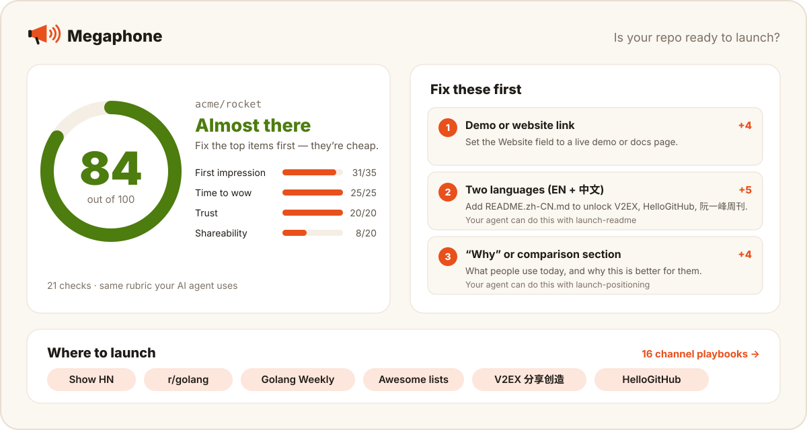

# 📣 Megaphone

Launch your open-source project the way a marketer would — even if you've never launched anything.

[](LICENSE)
[](skills)
[](skills/launch-posts/channels)
[](#quick-start)

English | [简体中文](README.zh-CN.md) · [**Try the checker →**](https://2104178150-ai.github.io/megaphone/)



- **Know if you're ready** — blockers a visitor would hit, risks that grow with visibility, and a 0–100 score from 21 checks. [Score any repo in your browser](https://2104178150-ai.github.io/megaphone/), no install.
- **The right post for each channel** — Show HN, Reddit, Product Hunt, X, V2EX, HelloGitHub, 阮一峰周刊, 小红书 and more: a native draft written to each platform's rules, or, where a platform wants your own words (Show HN, V2EX, 掘金, Lobsters), a fact sheet you write from. Rules come with sources and a "last checked" date.
- **See what actually worked** — star history and referrers lined up against what you posted, when.

## Quick start

Install the skills into your coding agent (Claude Code, Codex, OpenClaw, Cursor and [70+ others](https://github.com/vercel-labs/skills#supported-agents)):

```bash
npx skills add 2104178150-ai/megaphone
```

Then, inside your project, ask your agent:

> launch this repo

Prefer a Claude Code plugin?

```bash
claude plugin marketplace add 2104178150-ai/megaphone
claude plugin install megaphone@megaphone
```

Inside a session the skills are then available as `/megaphone:launch`, `/megaphone:launch-audit` and so on.

Needs: a coding agent that supports skills, and Python 3.8+ for the bundled scripts (standard library only). The web checker needs only a browser.

## Why Megaphone?

> I study communications, and I wanted to make something everyone could use. Then I noticed
> how many good projects get built and then nobody looks at them.
>
> I think the biggest problem when developers promote their work is that they talk about the
> tech, not the benefits — or they're so busy building features that they forget how to win
> users.
>
> I can't code. The code was written by AI; I set the direction and kept the quality bar.
>
> What I'm proudest of is having looked over seven indie developers' projects for them.
>
> — the author, [@2104178150-ai](https://github.com/2104178150-ai) (translated from Chinese)

Most good open-source projects don't fail because they're bad. They fail because the
author posts one link to Hacker News, gets two upvotes, and concludes nobody cares.
Launching well is a skill — positioning, a README that converts, knowing each
community's rules, timing, and measuring — and most developers never had a reason to
learn it.

| | Megaphone | Generic marketing prompt packs | "Where to post" lists |
|---|---|---|---|
| Reads your repo before writing anything | ✅ | ❌ | ❌ |
| Channel rules with sources and dates | ✅ | Partly | ❌ |
| Chinese developer channels (V2EX, HelloGitHub, 即刻, 小红书…) | ✅ | ❌ | Some |
| Measures which channel worked | ✅ | ❌ | ❌ |
| Try it without installing anything | ✅ [web checker](https://2104178150-ai.github.io/megaphone/) | ❌ | — |
| Refuses vote-gaming | ✅ | Varies | Varies |

## What's inside

### Skills

| Skill | What it does | Writes |
|---|---|---|
| [`launch`](skills/launch/SKILL.md) | Runs the whole pipeline below, pausing for your review at each step and recording your answers | `.megaphone/decisions.md` |
| [`launch-audit`](skills/launch-audit/SKILL.md) | Finds blockers, answers risk & readiness questions, and scores the README with the [public rubric](skills/launch-audit/rubric.md) | `.megaphone/audit.md` |
| [`launch-positioning`](skills/launch-positioning/SKILL.md) | Finds the one-liner: audience, alternative, proof, contrast — and the claims you won't make | `.megaphone/brief.md` |
| [`launch-readme`](skills/launch-readme/SKILL.md) | Rewrites the README's first screen; optional twin in a second language | `README.md`, or a proposal in `.megaphone/` |
| [`launch-posts`](skills/launch-posts/SKILL.md) | Picks channels, says why it skipped the others, and drafts one native post per channel (a fact sheet where the platform wants the author's own words) | `.megaphone/posts/` |
| [`launch-plan`](skills/launch-plan/SKILL.md) | Dated, timezone-aware launch calendar with a go/no-go, and a posting log | `.megaphone/plan.md`, `log.csv` |
| [`launch-review`](skills/launch-review/SKILL.md) | Star history, traffic and per-post attribution | `.megaphone/report.md` |

### The audit: blockers, risks, score

1. **Blockers** — what would make a visitor leave, found by reading the README the way
   someone from your first channel would: a quick start that doesn't show the point, a
   hidden hard requirement, no license, a broken install. Any open blocker caps the level
   at *Needs polish*, whatever the score.
2. **Risk & readiness** — what gets worse once the project is visible: unofficial APIs,
   copyright, privacy, a hosted demo that can't take a burst. Answered, not scored.
3. **The 100-point score** — 21 mechanical checks from the [public rubric](skills/launch-audit/rubric.md).
   When a check passes or fails on a technicality, the audit also gives a human-adjusted
   score and says why.

### Channel playbooks

Each one covers fit, rules, format, timing, a template and pitfalls, with a "Last checked"
date. Rules link to the platform's own pages where we found them; community habits and
heuristics are labelled as such. [Browse all →](skills/launch-posts/channels)

**Global:** [Hacker News](skills/launch-posts/channels/hacker-news.md) ·
[Reddit](skills/launch-posts/channels/reddit.md) ·
[Product Hunt](skills/launch-posts/channels/product-hunt.md) ·
[X / Bluesky](skills/launch-posts/channels/x-twitter.md) ·
[DEV & blogs](skills/launch-posts/channels/dev-blogs.md) ·
[Lobsters](skills/launch-posts/channels/lobsters.md) ·
[Awesome lists](skills/launch-posts/channels/awesome-lists.md) ·
[Newsletters](skills/launch-posts/channels/newsletters.md) ·
[GitHub itself](skills/launch-posts/channels/github-native.md) ·
[Plugin directories & host apps](skills/launch-posts/channels/ecosystems.md)

**Chinese:** [V2EX](skills/launch-posts/channels/v2ex.md) ·
[HelloGitHub](skills/launch-posts/channels/hellogithub.md) ·
[阮一峰周刊](skills/launch-posts/channels/ruanyf-weekly.md) ·
[即刻](skills/launch-posts/channels/jike.md) ·
[小红书](skills/launch-posts/channels/xiaohongshu.md) ·
[掘金](skills/launch-posts/channels/juejin.md) ·
[知乎 / B 站 / 开源中国 / 少数派 / Gitee](skills/launch-posts/channels/china-other.md)
— written in Chinese, each with an English summary at the top.

### Web checker and audit script

[`docs/`](docs) is a static page (no build, no dependencies, no server) that scores any
public repo with the same rubric, recommends channels, writes the prompt that hands the
failed checks to your agent, and gives you a badge for your README. It runs in the browser and
reads GitHub directly: the API, plus raw.githubusercontent.com for the README (falling back to
the API where that's blocked). It gives the score only; blockers and risks need the human
review in `launch-audit`.

[`audit.py`](skills/launch-audit/scripts/audit.py) gives the same score in a terminal, and
can score a local draft before you push it. Shared cases in
[`tests/fixtures/rubric-cases.json`](tests/fixtures/rubric-cases.json) keep the two in sync.

```bash
python3 skills/launch-audit/scripts/audit.py OWNER/REPO                     # what's on GitHub now
python3 skills/launch-audit/scripts/audit.py OWNER/REPO --readme README.md  # a local draft
```

## How a launch runs

```text
audit ──▶ positioning ──▶ README first screen ──▶ channel posts ──▶ plan ──▶ (you post) ──▶ review
  │            │                   │                     │             │                        │
audit.md    brief.md           README.md            posts/*.md      plan.md               report.md
```

Everything lands in a `.megaphone/` folder in your repo so you can read, edit and
decide. The `launch` skill adds it to `.gitignore` by default: it holds unpublished drafts
and, later, traffic snapshots that GitHub shows only to people with push access. Your
answers, and any assumptions the agent made while you were away, go in `decisions.md` so
later stages don't ask twice. Megaphone never publishes, submits or emails anything on
your behalf.

## Principles

- **You publish; the agent drafts.** Platforms punish automation, and your name is on it.
- **Never ask for votes or stars.** It's against Hacker News, Product Hunt and Reddit
  rules, and it gets posts killed.
- **Honest claims only.** No invented numbers or testimonials; unknowns become `[TODO]`.
- **Never invent the author's voice.** "I built this because…" is yours to write. Without
  your words, the agent leaves a `[TODO]` rather than making up an origin story.
- **Check whether visibility could hurt.** Before making a project louder, look at what a
  launch exposes: unofficial APIs, copyrighted media, other people's data, a service that
  can't take a burst. No draft promises "zero risk" or "100% legal".
- **Native, not translated.** Chinese channels get posts written in Chinese, for that
  audience. Posts are drafted only in languages you can reply in.

## FAQ

**Will this get me stars?** It gets your project in front of the people who'd want it,
in a form they'll actually try. Whether they star it is up to the project.

**Does a high score mean it'll succeed?** No. The score measures the README's shape: can a
visitor see what it is, what it looks like and how to try it. Blockers measure whether it
actually works for that visitor: a 100/100 README whose quick start doesn't show the
headline feature still rates *Needs polish*. No score tells you whether people want the
project.

**Do I need a GitHub token?** Only for `launch-review`, and it should be the maintainer's:
GitHub lists stargazers only to authenticated requests and is limiting the list to a
repo's admins and collaborators ([docs](https://docs.github.com/en/rest/activity/starring)),
and traffic data needs push access. Everything else works without one; the checker and
`audit.py` accept one if you run out of anonymous requests.

**Is the checker private?** It runs entirely in your browser; there's no Megaphone server.
Repo data comes straight from GitHub (the public API and raw.githubusercontent.com), and the
badge preview is a shields.io image whose URL carries only the score. Anonymous API requests
are limited to 60 an hour per IP; a check uses three to five, and results are cached in
your browser for an hour.

**My project is in Chinese / English only. Is that a problem?** No. A second language is
worth 5 of the 100 points because it unlocks more channels. If you won't launch in one,
`launch-audit` records it as an accepted trade-off and scores the rest.

## Contributing

Platforms change their rules; the playbooks are only as good as the last person who
checked them. If you notice drift, [open a "channel rule changed" issue](../../issues/new/choose)
or send a PR — every playbook has a "Last checked" date and says where its facts come from.
[`scripts/check_sources.py`](scripts/check_sources.py) re-reads the platform pages behind
key playbook facts and flags the ones that changed upstream. See
[CONTRIBUTING.md](CONTRIBUTING.md) for adding a channel or changing the rubric.

Run the tests:

```bash
python3 -m unittest discover -s tests       # launch-review script, and audit.py against the shared rubric cases
python3 -m http.server 8820                  # then open http://localhost:8820/tests/ for the checker (same cases)
```

Questions and launch stories are welcome in [Discussions](../../discussions).

## License

[MIT](LICENSE)
