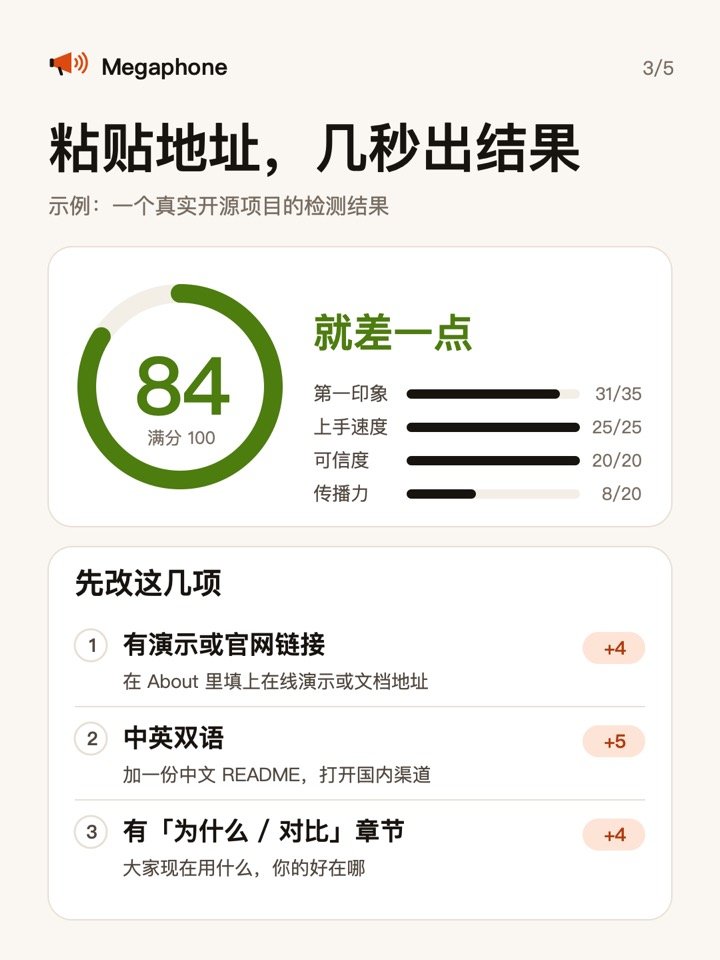

# Megaphone launching itself · Megaphone 给自己做的发布

[中文](#中文) · [English](#english)

## 中文

这个文件夹里是 Megaphone 的技能为它自己准备、并且真的发出去了的东西：

| 渠道 | 准备了什么 | 为什么这样做 |
|---|---|---|
| 小红书 | 5 张 3:4 配图（`xiaohongshu-1.jpg` … `5.jpg`）+ 文案和话题（[xiaohongshu.md](xiaohongshu.md)） | 小红书要求发布时声明 AI 辅助，图片和正文里也不能放站外链接，所以只写「GitHub 搜……」 |
| V2EX | 只有事实清单和提纲（[v2ex.md](v2ex.md)），没有现成正文 | V2EX 规定主题和回复都不能用 AI 生成的文字，正文要作者本人写 |
| 掘金沸点 | 作者回答 4 个问题，用自己的话写成；[发出的沸点](https://juejin.cn/pin/7697470958782169088) | 掘金把直接发布 AI 生成的技术内容算作抄袭类违规 |
| 中国独立开发者项目列表 | 按它的格式写好的一行介绍；[已收录](https://github.com/1c7/chinese-independent-developer/pull/1599) | 程序员版收命令行和开源项目，主版面只收网站和 App |

  
  

## English

What Megaphone's own skills prepared for its launch, and what actually went out:

| Channel | What was prepared | Why |
|---|---|---|
| 小红书 (Xiaohongshu) | Five 3:4 images and the note text with topics ([xiaohongshu.md](xiaohongshu.md)) | The platform requires declaring AI help at publish time and bans off-platform links, so the post says what to search for instead |
| V2EX | A fact sheet and outline only ([v2ex.md](v2ex.md)) | V2EX's rules ban AI-generated text in topics and replies; the author writes the post |
| 掘金 (Juejin) | The author's own answers to four questions; [the published post](https://juejin.cn/pin/7697470958782169088) | Juejin treats AI-generated technical content posted directly as plagiarism |
| Chinese Independent Developer list | One line in the list's format; [merged](https://github.com/1c7/chinese-independent-developer/pull/1599) | Its programmer edition takes CLI and open-source projects |
